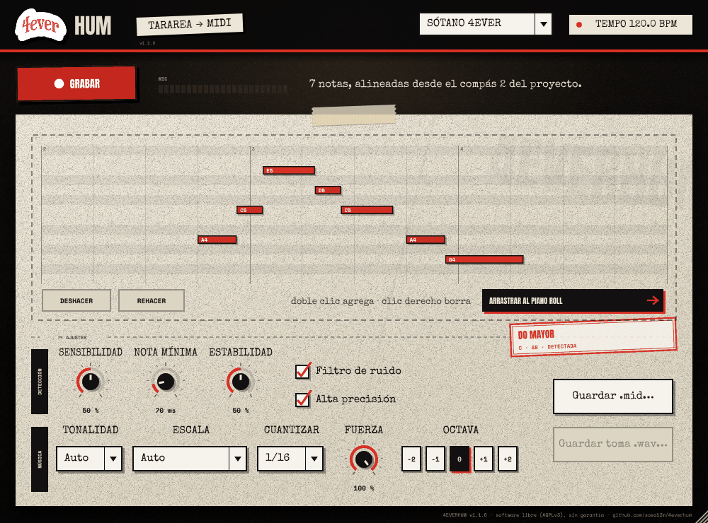
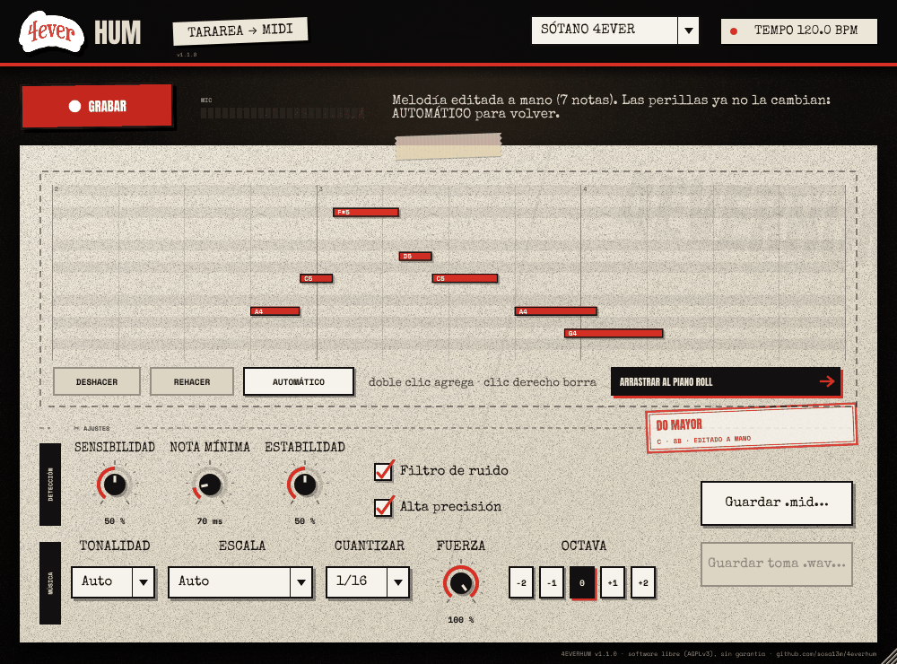
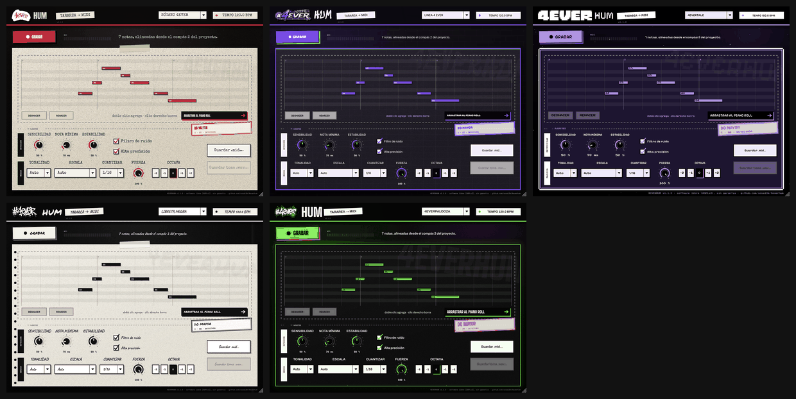

<div align="center">

# 4EVERHUM

**Tararea una melodía. Arrástrala al piano roll.**

Plugin gratis y de código abierto para FL Studio, Ableton, Logic, Reaper y cualquier DAW.
De la familia **4EVERTOOLS** · colectivo **4EVER** (Chile).

[](https://github.com/sosa13m/4everhum/releases/latest)
[](https://github.com/sosa13m/4everhum/actions/workflows/build.yml)
[](LICENSE)

### [⬇ Descargar para Windows](https://github.com/sosa13m/4everhum/releases/latest/download/4EVERHUM-windows.zip) · [⬇ Descargar para Mac](https://github.com/sosa13m/4everhum/releases/latest/download/4EVERHUM-macos.zip)



</div>

## Qué hace

1. **Grabas** tu voz tarareando, cantando o silbando, con el beat sonando.
2. 4EVERHUM **detecta las notas**, la **tonalidad** (con código Camelot) y las
   ajusta a la **escala** y al **grid** de tu proyecto.
3. La **arrastras** al piano roll de cualquier instrumento (Purity, Nexus, Serum…)
   y la melodía queda en su compás.

Si algo no quedó como querías, giras una perilla y se recalcula al instante, o
editas las notas a mano en el mismo plugin. No hace falta volver a grabar.

## Instalar

### Windows 10 / 11

1. [Descarga `4EVERHUM-windows.zip`](https://github.com/sosa13m/4everhum/releases/latest/download/4EVERHUM-windows.zip)
   y descomprímelo (clic derecho → *Extraer todo*).
2. Doble clic en **`instalar.bat`** y acepta el permiso de administrador.
3. En FL Studio: **Options → Manage plugins → Find plugins**.

### macOS 10.15 o más nuevo (Apple Silicon e Intel)

1. [Descarga `4EVERHUM-macos.zip`](https://github.com/sosa13m/4everhum/releases/latest/download/4EVERHUM-macos.zip)
   y descomprímelo.
2. Abre la **Terminal**, escribe `bash ` (con un espacio), arrastra
   **`instalar.command`** a la ventana y pulsa Enter.
3. FL Studio: **Find plugins**. Logic / GarageBand: aparece en
   *Audio Units → 4EVERTOOLS → 4EVERHUM*.

Se instala el plugin **VST3** (y **AU** en Mac), una **app que funciona sin DAW** y
la herramienta de terminal `hum2midi`. Para desinstalar está `desinstalar.bat` /
`desinstalar.command`.

## Usar (FL Studio)

1. En el **Mixer**, elige un track libre y pon tu micrófono como entrada.
2. Agrega **4EVERHUM** en un slot de efectos de ese track.
3. Pulsa **GRABAR**, tararea y pulsa **DETENER**. Usa audífonos para que el beat
   no entre al micrófono.
4. Abre el piano roll de tu instrumento y arrastra la melodía desde el botón
   negro **ARRASTRAR AL PIANO ROLL**.

En otros DAWs es igual: 4EVERHUM va como efecto en la pista del micrófono. El
plugin no altera el audio, la señal pasa tal cual.

## Controles

**Detección** (cómo se escucha tu voz)

| Control | Si pasa esto… | …haz esto |
|---|---|---|
| **Sensibilidad** | Se pierden notas / aparecen notas que no cantaste | Súbela / bájala |
| **Nota mínima** | Salen notas cortitas sueltas / se pierden notas rápidas | Súbela / bájala |
| **Estabilidad** | Una nota larga se parte en varias / dos notas salen como una | Súbela / bájala |
| **Filtro de ruido** | El beat se cuela en el micrófono | Déjalo activado |
| **Alta precisión** | La voz salta de octava (voz grave o rasposa) | Déjalo activado |

**Música** (cómo queda la melodía)

- **Tonalidad**: en *Auto* la detecta y la estampa en el sello rojo
  (`LA MENOR · Am · 8A`). Si ya sabes en qué tonalidad está el beat, elígela.
- **Escala**: cada nota cae en la nota de la escala más cercana a lo que cantaste.
  Mayor, menor, menor armónica, dórica, frigia, pentatónicas o *sin escala*.
- **Cuantizar** y **Fuerza**: de 1/4 a 1/32 y tresillos. Con menos de 100% de
  fuerza conserva algo de tu groove.
- **Octava**: sube o baja toda la melodía.

Si grabas con el proyecto sonando, las notas quedan en su **compás real**.

## Editar a mano



**Clic** para elegir una nota y **arrastrar** para moverla. Arrastrando el **borde
derecho** la alargas; con **doble clic** agregas una nota y con **clic derecho** o
**Supr** la borras. Ctrl+Z / Ctrl+Y deshacen y rehacen. **Automático** descarta las
ediciones y vuelve a lo detectado. Todo se guarda con el proyecto.

## Temas



Los mismos temas de 4EVERTOOLS: **SÓTANO 4EVER**, **LINEA 4 EVER**, **4EVERTALE**,
**LIBRETA NEGRA** y **4EVERPALOOZA**. Se eligen arriba a la derecha y el plugin
recuerda tu elección.

## Preguntas frecuentes

**Windows dice "Windows protegió su PC".**
El instalador no está firmado digitalmente (un certificado cuesta dinero). Haz
clic en *Más información → Ejecutar de todas formas*.

**macOS dice que no puede abrir `instalar.command` o que está dañado.**
Instálalo desde la Terminal como en el paso 2 (`bash ` + arrastrar el archivo).
El instalador le quita la cuarentena al plugin para que macOS lo deje cargar.

**FL Studio no encuentra el plugin.**
Corre *Find plugins* después de instalar. 4EVERHUM es un **efecto**: búscalo en
un slot del Mixer, no en el Channel Rack. En Windows debe estar en
`C:\Program Files\Common Files\VST3\4EVERHUM.vst3`.

**El medidor MIC no se mueve.**
Revisa que el track del Mixer tenga tu micrófono como entrada. En Windows:
*Configuración → Privacidad → Micrófono* tiene que permitir el acceso a apps de
escritorio. En Mac: acepta el permiso de micrófono. En la app sin DAW: *Options →
Audio/MIDI Settings* y desmarca **Mute audio input**.

**Las notas salen una octava más arriba o más abajo.**
Usa **Octava**. Ojo: FL Studio llama **C5** al Do central (otros DAWs dicen C4),
y 4EVERHUM usa la misma convención que FL.

**¿Funciona en tiempo real?**
No: grabas, el plugin analiza (menos de un segundo) y arrastras. Así el
resultado es mucho más preciso que convertir la voz nota por nota en vivo.

**¿Puedo usar las melodías en mis temas, incluso comerciales?**
Sí. Lo que creas con 4EVERHUM es tuyo; la licencia AGPL aplica al código del
plugin, no a tu música.

**Detectó mal mi voz.**
[Abre un reporte](https://github.com/sosa13m/4everhum/issues/new/choose) y adjunta la
toma (botón **Guardar toma .wav…**): con eso se puede mejorar el motor.

## hum2midi (terminal)

El mismo motor, sin abrir el DAW. Acepta WAV, AIFF, FLAC y MP3:

```
hum2midi toma.wav --bpm 140 --tonalidad Am --cuantizar 1/8
hum2midi --ayuda
```

---

## Para desarrolladores

### Compilar

Requisitos: CMake 3.22+, Git y un compilador C++20 (Visual Studio 2022 en
Windows, Xcode en Mac). JUCE 8 se descarga solo la primera vez.

```bash
cmake -B build -DCMAKE_BUILD_TYPE=Release
cmake --build build --config Release --target FourEverHum_VST3 FourEverHum_Standalone hum2midi
ctest --test-dir build -C Release --output-on-failure
```

En Mac, agrega `FourEverHum_AU` para el Audio Unit.

### Publicar una versión

Cada push a `main` compila Windows y Mac en GitHub Actions, corre los tests, y
valida el plugin con pluginval (y el AU con auval). Para publicar:

1. Sube la versión en `CMakeLists.txt` (`project(FourEverHum VERSION x.y.z)`).
2. Agrega la sección `## x.y.z` en `CHANGELOG.md`.
3. `git tag vx.y.z && git push origin vx.y.z`

Eso crea la Release con `4EVERHUM-windows.zip` y `4EVERHUM-macos.zip`, y las
notas sacadas del CHANGELOG.

### Tests

- `dsp_tests`: voz sintética (vibrato, ruido, portamento) a 44.1/48/96 kHz, cada
  perilla, y un cantante desafinado 35 cents y desfasado 40 ms que tiene que salir
  exacto en escala y en corcheas.
- `music_tests`: tonalidad en las 12 transposiciones, Camelot, escalas, grid y
  tresillos, alineado al compás.
- `edit_tests`: edición manual y deshacer/rehacer.
- `bench_pitch`: YIN vs pYIN con voces difíciles y altura real conocida.
- `midi_export_test`: voz → `.mid` en disco → se relee y se verifica.

Los tests pasan con GCC, Clang/libc++ y con AddressSanitizer + UBSan.

### Estructura

```
Source/dsp/        Deteccion (YIN, pYIN), segmentacion, tonalidad/escalas/grid, edicion
Source/midi/       Exportacion .mid
Source/ui/         Piano roll editable, LookAndFeel, temas
Source/Plugin*     Procesador (grabacion, analisis en segundo plano, estado) e interfaz
tools/hum2midi.cpp Conversor por terminal
tests/             Tests y banco de pruebas
packaging/         Instaladores, LEEME y notas de version
Resources/         Tipografias (con sus licencias) y logos
```

### Licencia

4EVERHUM es software libre bajo la **GNU AGPL v3 o posterior** ([LICENSE](LICENSE)).
Usa JUCE 8 bajo AGPLv3 y tipografías bajo OFL 1.1 / Apache 2.0: detalle en
[TERCEROS.md](TERCEROS.md). El nombre y los logos de 4EVER son del colectivo y no
forman parte de la licencia.

---

**English:** 4EVERHUM is a free, open-source (AGPLv3) VST3/AU plugin and
standalone app: hum a melody, it detects the notes, key (with Camelot code), snaps
them to a scale and the grid, and you drag the MIDI clip into any DAW's piano
roll. Downloads for [Windows](https://github.com/sosa13m/4everhum/releases/latest/download/4EVERHUM-windows.zip)
and [macOS](https://github.com/sosa13m/4everhum/releases/latest/download/4EVERHUM-macos.zip)
(universal). The interface is in Spanish.
